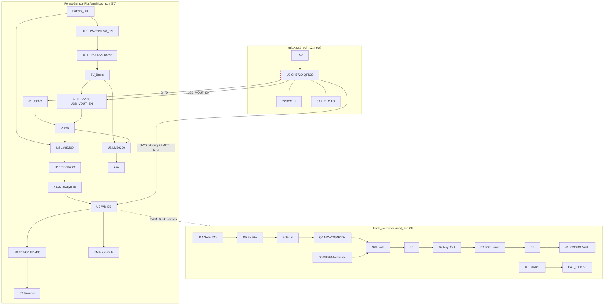

# Forest Sensor Platform - full board review

Date: 2026-08-22 (supersedes the 2026-08-20 review).
Reviewed: `Forest-Sensor-Platform.kicad_sch` + `buck_converter.kicad_sch` + `usb.kicad_sch`
+ `Forest-Sensor-Platform.kicad_pcb` as saved 19:37-19:38 on 2026-08-22
(working tree on branch `split`, HEAD = `00e6347`, all sheet/PCB changes uncommitted).
Tooling: kicad-cli 10.0.4 ERC/DRC on a scratch copy with every ignored check re-enabled,
netlist export per sheet, pad-level PCB cross-check, WCH CH572 datasheet (V1.1) and the
official CH572 EVT reference schematic from `openwch/ch570`.

18 findings: 2 blockers, 5 high, 8 medium, 3 low groups. The headline: the Q2 gate-pin
blocker from the last four reviews is **fixed and verified on the PCB**, the new CH572D
block is pin-accurate against the datasheet, and the PCB is in near-perfect sync with the
schematics (353 of 354 pins agree). The one pin that does not agree is the new blocker.

## Board at a glance

- 4 layer, 57.00 x 66.00 mm; stackup now declared (0.035/0.1 prepreg/1.24 core/0.1/0.035,
  1.58 mm total). GND zone on all four layers, +3.3V island on In2.Cu.
- 114 footprints: 70 main sheet + 32 buck sheet + 12 new USB sheet. Ref parity is exact.
- New since last review: the CH572D USB/BLE block moved off the main sheet into
  `usb.kicad_sch` (U9 bare QFN20 + 32 MHz crystal Y2 + U.FL J9 + LEDs), U4 removed.

## Fixed since 2026-08-20 - verified, not assumed

- **B1 closed.** `buck-wio:MCAC054P10Y-TP` now numbers S = 1-3, **G = 4**, D = 5-8, matching
  the MCC datasheet, and on the PCB pad 4 carries `Net-(Q2-G)` while pads 1-3 carry Solar In.
  The buck can switch. (The symbol Description still carries the old SUD08P06 text - cosmetic.)
- The PCB was re-synced: only one (ref,pin) in the whole design now disagrees between
  schematic and board (see B1 below). Last review had a whole sheet unbacked.
- R38/R39/R40 have real values (1K); R35/R33/R34 sensor-supply strap drawn with R33 properly DNP.
- WIO-RST regained its 100 nF (C32) plus R29 10k pull-up; SW1 and J2.5 wired to it.
- A stackup is declared and totals ~1.6 mm.

## Blockers

### B1 - The CH572D has no ground: the exposed pad carries no net

The QFN20 CH572D's **only ground connection is the exposed pad** (the datasheet numbers it
pin 0/GND; there is no other GND pin on the package). In `buck-forest.pretty/CH572D.kicad_mod`
the EP is drawn as four 0.67 mm sub-pads whose pad name is the **empty string**, so:

- the symbol's pin 21 (GND, power_in) maps to no pad - the netlist cross-check shows
  U9.21 as the single schematic pin with no PCB counterpart;
- on the board all four center pads have **no net**, so the GND pour keeps clearance from
  them instead of connecting.

As routed, the chip has no ground and no RF return: it simply cannot work, and neither ERC
nor DRC flags it (an unnamed pad with no net is legal in both). The footprint's descr string
still points at an Analog Devices QFN template, which is where the unnamed-EP style came from.

Fix: rename the four center pads to `21` (or replace them with one 1.55 mm pad "21"),
update the board, let the zones connect, and add 2-4 GND vias in/next to the EP - it is the
RF ground for the 2.4 GHz radio. Then re-check thermals/paste on the EP.

### B2 - Still three disconnected schematic roots, plus an empty fourth

Unchanged in substance from last review, but now bigger. None of the four .kicad_sch files
contains a `(sheet ...)` node: `Forest-Sensor-Platform.kicad_sch`, `buck_converter.kicad_sch`
and `usb.kicad_sch` are all standalone roots, and `board.kicad_sch` is an empty root
(page 3 - presumably the started-but-abandoned new top sheet).

The PCB pads record what the hierarchy last was: net prefixes `/Forest-Sensor-Platform/...`,
`/Buck Converter/...` and `/USB/...` mean a root sheet containing **three** subsheets with
exactly those names. `.kicad_pro` still lists all three sheet UUIDs.

Until it is restored:

- The 13 cross-sheet globals connect nowhere: `D+`, `D-`, `USB_VOUT_EN`, `SWD-WIO-CLK`,
  `SWD-WIO-IO`, `WIO-RST`, `UART-WIO-TX`, `UART-WIO-RX` (USB sheet) and `PWM_Buck`,
  `BAT_ISENSE`, `VSENSE_VIN`, `VSENSE_OUT`, `Battery_Out` (buck sheet). USB cannot reach
  the CH572D, the CH cannot program the Wio, the Wio cannot drive the buck.
- ERC runs one sheet at a time (66 findings across the three, six of them errors that are
  mostly artifacts of the split); DRC parity reports 44 extra footprints and 54 net conflicts.
- A BOM export from any root misses the other two sheets.

Fix: put three sheet symbols into `board.kicad_sch` (or the main file) named exactly
`Forest-Sensor-Platform`, `Buck Converter` and `USB`, pointing at the three files; the PCB
net names then line up instead of being rewritten. Re-run ERC and DRC parity for the first
whole-board pass, and commit all four .kicad_sch files.

## High

### H1 - VDD33/VIO33 have zero decoupling; both required caps sit on the wrong node

The CH572 datasheet power scheme for single-5V supply: V5 pin takes 5 V into the internal
LDO5V, **a rated 1.5 kohm resistor in series between V5 and VDD33** (R41 - correctly done,
this vindicates the odd-looking resistor), **2.2 uF close to V5**, and **2.2 uF parallel
0.1 uF close to VDD33**. VIO33 must be shorted to VDD33 (done).

On the board C28 (2.2u) and C29 (100n) are both on the **+5V/V5 side** of R41, and
`Net-(U9-VDD3)` contains only R41, pin 6 and pin 7 - not one capacitor on the LDO output
that actually powers the core and radio. Fix: keep C28 at V5, move C29 to VDD3, add a
2.2 uF at VDD3. (The ERC error "U9 pin 6 VDD3 not driven" is this finding's shadow; a
PWR_FLAG on the node will silence it once the caps are there.)

### H2 - The 18 pF crystal caps must not be fitted

CH572 loads the 32 MHz crystal with **built-in tunable capacitors** (R8_XT32M_TUNE /
RB_XT32M_C_LOAD: 6-20 pF per pin, "usually 111b"), and the official EVT schematic runs the
crystal with **no external load caps at all**. Y2 (XRCGB32M000F1S1DR0) is specified for
CL = 12 pF, which the internal caps are designed to provide.

C26/C27 = 18 pF on top of the internal load pushes effective CL to roughly 19 pF+: the
oscillator runs tens of ppm low and startup margin shrinks - on a BLE radio that is a
frequency-offset/link failure, not a cosmetic drift. Set C26/C27 to DNP (keeping the
footprints as insurance is fine).

### H3 - The unpowered CH572D back-powers through its ESD diodes and can clamp WIO-RST

Power domains: +3.3V (Wio, RS-485, pulls) is always on via U8/U10. The CH572D is powered
**only from +5V**, which is off by default - the boost is gated by 5V_EN (1M pulldown, off
at reset) and USB may not be plugged. So in the normal battery-only boot the CH is dark
while these nets are driven high against it:

- `WIO-RST`: R29 10k pull-up to +3.3V, shared with **U9.15 (PA6)**. With U9 unpowered, PA6's
  ESD diode clamps the net toward VDD33+0.6 V. VDD33 floats (no caps, only R41 to a dead
  rail), so where WIO-RST settles depends on diode leakage - it can sit low enough to hold
  the Wio-E5 in reset, in which case 5V_EN is never asserted, the boost never starts, and
  **the node never boots**. Even in the benign case the CH is phantom-powered at ~2.5 V
  through protection diodes continuously.
- Same class of path: R23/R24+LEDs into PA3/PA2, Wio UART2 TX (idle high once configured)
  into PA9, SWD bit-bang lines into PA5/PA7.

Cleanest fix: power the CH from the always-on +3.3V rail - the datasheet's single-3.3V
configuration (VDD33+VIO33 = 3.3 V, V5 floating or tied to VDD33; R41 then DNP). Sleep
current is negligible, USB still works because +3.3V is up whenever VUSB is (VUSB feeds U8),
and every back-power path disappears. If the 5V-only scheme must stay, every shared net
needs series isolation and the WIO-RST pull-up has to move to a net the CH cannot clamp.

### H4 - Still no hardware overvoltage clamp on Battery_Out

Unchanged from last review. If the pack is removed at J6 or F1 trips while the panel
delivers, the buck output rises toward the panel rail with only firmware watching
VSENSE_OUT (whose /2 divider saturates the ADC at 6.6 V). U13 and U8 are 6 V absolute
maximum, C22/C23 are 10 V. Add an SMAJ5.0A (or 5.6 V zener sized for the buck's current
limit) on Battery_Out.

### H5 - Both LM66200 status LEDs still cannot light

Unchanged: ST is open-drain (TI SLVSG04 7.3.3, "must be pulled up") but D2 and D6 still
have the anode on ST with only a resistor to GND below - dark in both states. D10/D11/D12
on this very board show the correct pattern (rail -> R -> LED -> pin). Rewire D2/R13 and
D6/R16 the same way.

## Medium

### M1 - Input TVS still clamps above the Schottky ratings

D4 = P6SMBJ43A (69.4 V max clamp) vs 60 V V_RRM on D5/D8. The panel is now documented on
the sheet as ~24 V / 23.6 VOC, so an SMBJ30A-SMBJ36A (49.9-58.1 V clamp) protects the
diodes with panel headroom to spare. Carried from last review.

### M2 - Battery_Out is still split at the shunt

The R12/R14 voltage-sense divider still taps the battery only through R1's terminal metal:
the two same-numbered pads of terminal 3 have no copper between them and
`duplicate_pad_numbers_are_jumpers` is off, so DRC keeps reporting it (plus the two benign
R1/SW1 pad-pair items). Join the pads with copper or set the jumper flag on the footprint.

### M3 - No way to (re)program the CH572D

The bootloader is enabled by default (CFG_BOOT_EN = 1b) and a blank chip enumerates over
USB, but re-entering the bootloader after firmware is flashed needs the boot condition:
the EVT provides a Download button feeding VDD33 through 5.1 k into **PA1 (BOOT)** at
power-on, plus an RST button on PA8. This board has neither, and PA1 is the USB D+ line, so
a bricked/misbehaving CH572D cannot be recovered in circuit. The `CH_USR_BTN` (PA10) and
`CH_GPIO` (PA11) labels dangle on wire stubs with no parts - the button seems intended but
was never placed, and PA10 is not the boot pin anyway. Add a button or 2-pad strap:
VDD3 -> 5.1k -> PA1/D+ net.

### M4 - RS-485 field lines still unprotected

No TVS, no 120 ohm termination, no fail-safe bias on RS422_A/B/Y/Z out to J7; D7 protects
only the supply pin. For an outdoor multi-drop bus this is the most likely field-failure
path. Carried from last review. (The half-duplex A-Y/B-Z strapping via R42/R43 is now
labeled "Duplex select tie" on the sheet - good.)

### M5 - U7 can still back-drive VBUS on a port strapped as a sink

R25/R26 declare J1 a sink; U7 pushes 5V_Boost onto VBUS with no reverse blocking and no
VBUS-presence sense anywhere (VUSB has no divider to any ADC/GPIO). If host-power-out is
intended, add VBUS sensing and interlock in the CH firmware at minimum; if not, delete U7.

### M6 - R35 is "100" ohm with a 0-ohm jumper MPN

Value says 100, MPN says RMCF0805ZT0R00 (zero-ohm). Decide which: at 100 ohm the J7 sensor
supply drops 1 V per 10 mA of load, which real field sensors will notice; if it is meant as
a jumper/fuse-slot, set the value to 0.

### M7 - The whole USB sheet is missing sourcing fields

U9, Y2, J9, C26-C29, D10, D11, R23, R24, R41 have no MPN / MANUFACTURER / Digi-Key PN /
Datasheet - the only sheet without them after the 2026-08-20 fill-out. Y2's footprint name
carries its MPN (XRCGB32M000F1S1DR0); the rest need the usual treatment or the BOM export
regresses.

### M8 - Rule hygiene unchanged: one netclass, zero minimums

Single Default class (0.2 mm), `min_track_width` / `min_clearance` / `min_connection` all
0, so DRC cannot flag an undersized power trace. Power routing is adequate by inspection
(Solar In 0.5 mm, Battery_Out 1.0 mm spine) but unenforced. Now that the stackup is
declared at 0.1 mm prepreg, note the SMA1 feed (0.3447 mm) computes to ~35-38 ohm rather
than 50 - harmless at 4.9 mm / 868 MHz, same for the 1.8 mm U.FL feed at 2.4 GHz, but worth
knowing before anyone lengthens either trace.

## Low

### L1 - The ignore lists still hide most findings

With every check enabled: ERC 66 (vs 0 shown), DRC 394 (vs stock run). The bulk is one
root cause - 0.5 mm silk text against the 0.8 mm minimum (179 items) - plus
silk-over-copper, missing courtyards (U3, the largest part, still has none), and the
footprint-type warnings. New real items in the error class this round:

- one genuine clearance violation: via on `Receiver_Input_Enable` 0.189 mm from a
  `Receiver_Output_Enable` track at (111.01, 98.56) - nudge the via;
- two GND vias 0.228 mm apart at (102.2, 96.25) against the 0.25 mm hole-to-hole rule;
- 10 starved thermals (single-spoke): U13.4, J1 GND x4, U8.5, U2.5, Y2.2, U1.2, U1.5 -
  raise spoke count or set those pads to solid connection;
- J1 pad-to-NPTH 0.194 mm and SMA1 edge clearance are footprint-inherent (stock GCT
  footprint, edge-launch SMA) - exclude them so they stop burying real errors, same for
  the eight U6 MSOP-10 pad-gap items.

### L2 - Names and leftovers that mislead

- `Receiver_Input_Enable`/`Receiver_Output_Enable` are still swapped relative to the pins
  they touch (wiring is correct); `/I2C-1-*` still lands on I2C2.
- Q2's symbol Description still describes the SUD08P06 it was cloned from.
- The main sheet's title block says "MPPT Buck NiMH charging" (the buck sheet's title).
- `CH572D.pretty/CH572D-Module.kicad_mod` + `CH572D-Module.step` are leftovers of the
  abandoned module approach - the PCB uses the bare QFN. Delete or archive them; the
  fp-lib-table entry keeps them available for accidental use.
- The always-on battery LED (D3+R19, ~2-3 mA continuous) still dominates the sleep budget.
- 1M enable pull-downs: still the leakage-sensitivity note from last review.
- No HF bypass at Q2's source (nearest Solar In cap 7.3 mm away); a 100 nF at the FET
  tightens the commutation loop.

### L3 - Repo state

Untracked and load-bearing: `usb.kicad_sch`, `buck_converter.kicad_sch`, `board.kicad_sch`,
`sym-lib-table`, `fp-lib-table`, `CH572D.pretty/`, `buck-forest.pretty/CH572D.kicad_mod`,
`buck-wio.kicad_sym`, `wio-e5-lib/`, `sd-card/`. `sym-lib-table` still lacks `buck-wio` and
`wio-e5` entries, which is exactly why ERC prints "library 'buck-wio' was not found" - the
placed symbols live only in each file's `lib_symbols` cache. A fresh clone still does not
open into a working project. Commit the sheet split as one change with the lib tables.

## Found at first power-up, 2026-11-03

The first hand-built board, fed 3.3 V at J4 with no firmware, held a 200 mA bench supply
in current limit while a meter found no short between 3V3 and GND. P1 and P2 together
caused it; with R33 off and D7 reworked the power check passed.

### P1 - D7's silkscreen marks its GND end as the cathode

D7 (SMAJ5.0CA, bidirectional) has A1 = pin 1 on GND, and `Diode_SMD:D_SMA` closes its
outline at pad 1, the mark a diode's cathode gets. A striped (unidirectional) part fitted
by that mark has its cathode on GND and conducts across whatever feeds the sensor supply,
holding it under 1 V; a resistance check reads that as open. The part on the BOM is
right; the board invites the substitute. Fix: swap D7's pins so pin 1 is on the
sensor-supply net. The mark then sits on the line side, where a unidirectional SMAJ5.0A
fitted by it is correct for this positive-only supply.

### P2 - Nothing on the board says R33 and R34 are either/or

R33 (+3.3V) and R34 (+5V) pick J7's sensor supply. The PCB carries R33's DNP flag, but its
silkscreen shows two ordinary pads, so a hand build fits both and ties +5V to +3.3V. In
the 3.3 V check that put D7, U9 and C28/C29/C44 on the rail under test, which is how P1
drew current; with USB or the boost on, U2's 5 V would reach the Wio-E5 (3.9 V absolute
maximum), U6, U1 and the SD card. Fix: a 3-pad solder jumper (center to the sensor
supply, outer pads to +3.3V and +5V), or at least "R33 OR R34" on the silkscreen.

## Found at first USB bring-up, 2026-11-04

The CH572D stayed silent on USB until both of these were fixed; the diagnosis and the
checks that find them are in CH572D-BRINGUP.md.

### P3 - Y2's footprint puts XI/XO on the crystal's joined no-connect pads

The buck-forest XRCGB32M000F1S1DR0 footprint is Murata's bottom view drawn as the top
view, which shorts XI to XO and leaves the CH572D with no clock. Fixed in the library
(b402d0c); the layout still needs Y2 updated and XI/XO rerouted.

### P4 - U9's exposed pad takes too much solder by hand

Excess solder under the exposed pad tilted U9 off some pins and leaked XI to GND. Not a
layout error; a hand build needs a thin, even layer.

## Verified correct this round

- **CH572D symbol pinout: every pin checked against the WCH datasheet diagram** (1 PA3,
  2 XO, 3 XI, 4 NC, 5 ANT, 6 VDD33, 7 VIO33, 8 V5, 9 PA9, 10 PA8, 11 UDM, 12 UDP, 13-18
  PA4/PA5/PA6/PA7/PA10/PA11, 19 NC, 20 PA2). No cloned-symbol pin error this time.
- **R41 = 1.5k between V5 and VDD33 is a datasheet requirement**, correctly implemented.
- **Y2 = 32 MHz** as required; U.FL antenna direct to ANT matches the DS recommendation
  ("connect directly to the antenna"); PA8's reset alternate is disabled by default
  (CFG_RESET_EN = 0) so using it as the UART line is safe.
- **USB**: D-/D+ to PA0/PA1 with correct polarity through to J1's A6/B6-A7/B7 pairs; CC
  5.1k sink straps; D10/D11 LEDs wired the correct open-drain way around.
- **Wio-E5 cross-wiring**: UART crossover correct (Wio PA2 TX -> CH PA9 RX5, CH PA8 TX5 ->
  Wio PA3 RX); SWD bit-bang PA5->SWCLK/PA7->SWDIO consistent with J2; PWM_Buck on PB10
  (TIM2_CH3); senses on PB14/PA10/PB13 (all ADC-capable); I2C on PB15/PA15; 5V_EN on PC0.
- **RS-485**: data/enable wiring all correct with right power-up idle states (carried).
- **Buck**: gate-drive chain (Q3 -> R58 -> Q1 push-pull, R54 pull-up, R56 22R, D1/R57/C24
  floating 12 V rail), diode orientations, shunt/INA181 polarity, PTC, divider ratios -
  all re-verified from the netlist.
- **PCB sync**: 353/354 pins agree between the three schematics and the board; the only
  mismatches are U9.21 (B1) and the known-benign U11 NC pads grounded on the PCB.

## Suggested order

1. B1 - give the CH572D its ground (footprint pad rename, resync, EP vias).
2. B2 - rebuild the hierarchy in `board.kicad_sch` with the three exact sheet names, then
   run the first whole-board ERC/DRC and commit everything.
3. H1 + H2 + H3 together - they are one workstream: decide the CH power source (3.3V rail
   recommended), place the VDD33 caps, DNP the crystal caps.
4. H4, H5 - clamp and LED rewiring; M1 TVS swap in the same pass.
5. M2, M3, M6 - shunt copper, boot strap, R35 decision.
6. M4, M5, M7, M8, L1-L3 - protection set, BOM fields, rules and hygiene.
7. P1 + P2 - D7 pin swap and an either/or sensor-supply strap, in the next layout pass.
