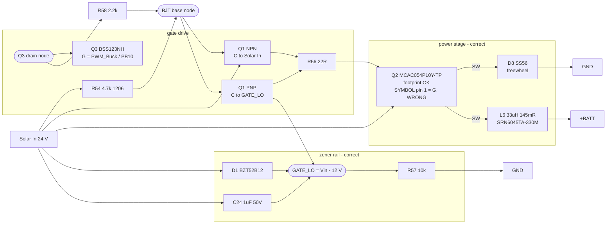
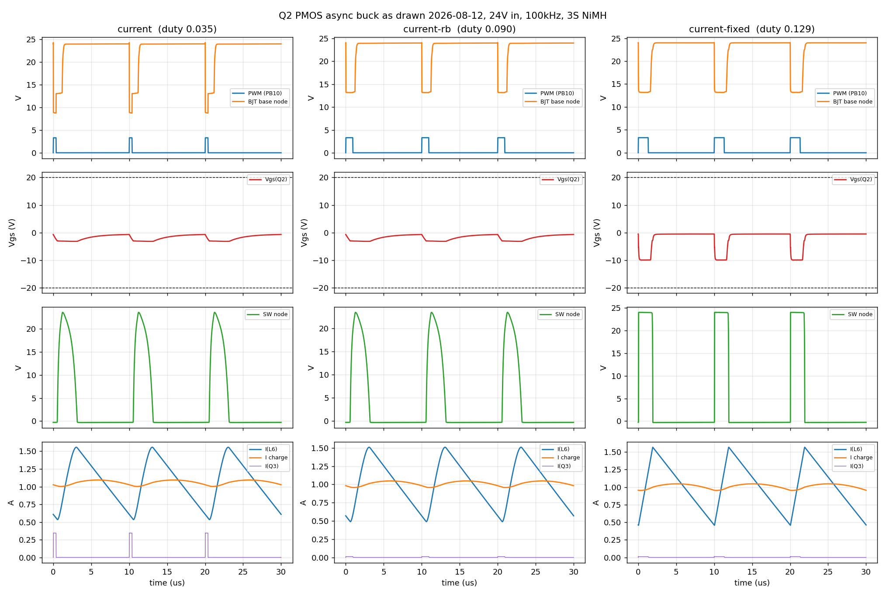

# Q2 high-side PMOS async buck - ngspice findings

Date: 2026-08-16
Schematic reviewed: `buck-converter-real.kicad_sch` as saved 16:43 on 2026-08-16
(md5 3551a33b43241f7314026e5ea19afb8f), PCB as saved 16:37
(md5 ff61f9125a5751e4414cc4b832c9e232). Supersedes all earlier revisions.
Operating point simulated: 24 V solar in, 100 kHz PWM, 3S NiMH charging at 1 A.
Netlists and driver in [sim-q2-pmos/](sim-q2-pmos/).

## TL;DR

The gate drive is now correct and fully controllable. **One blocker remains:**

> **Q2's symbol has the gate on pin 1; the MCAC054P10Y has it on pin 4.** The gate net
> routes to pad 1 (a source) and Solar In routes to pad 4 (the real gate), so V_GS is
> pinned at 0 and Q2 never turns on. This is now routed into the PCB as well.

Everything else measures correctly. With the symbol corrected the stage gives
**1.00 A at duty 0.147, V_GS -11.88 V, 87.7 % efficiency**, inductor 0.44-1.56 A (CCM),
Q3 peaking at 9.5 mA, and a smooth monotonic charge characteristic from 0.05 A upward
with no dead zone.

Resolved since the previous revisions:

| Item | Was | Now |
|---|---|---|
| R58 base resistor | wired base-node-to-GND, Q2 permanently ON | **in series, Q3.D -> R58 -> Q1.B1/B2** |
| R56 | raised to 2.2 k, V_GS -3.19 V, 55 % | **22 R** |
| D1 | `BZT52Bxx` placeholder | **BZT52B12, 12 V 500 mW** |
| R54 | 47 k, then 4.7 k on an 0603 | **4.7 k, 1206 footprint** |
| Q2 footprint | 3.05 mm body, no drain tab | **correct DFN5060 land pattern** |
| C11 / C20 | no voltage rating | **50 V** |
| Q1 / Q3 | generic | **MBT3946DW1T2G / BSS123NH6433XTMA1** |
| PCB | predated the rework | **re-synced**; C24 and C32 now placed |

**Correction carried forward:** an early revision of this report claimed D8 was wired in
parallel with R54 and shorted out the level shifter. That was wrong - a pin-transform bug
in the netlist extractor (section 6). D8 was never in that position.

## 1. The circuit as it now stands

`kicad-cli` 9.0.8 cannot load this v10 (20260306) schematic, so connectivity was
recovered by parsing the `.kicad_sch` s-expressions and resolving pin/wire geometry,
then cross-validated pin-by-pin against the PCB's own net names (section 6).



Nets, verbatim from the extractor:

- `Solar In`: Q2.S (pins 2,3,4), R54.1, Q1.C1, D1.K, C24.1, C11.1, C20.1, D4.K, D5.K, TP5
- Q3 drain node (N$3352): Q3.D, **R58.2**
- BJT base node (N$6354): Q1.B1, Q1.B2, **R58.1**, R54.2, TP6
- `GATE_LO` (N$2690): D1.A, C24.2, R57.1, **Q1.C2**
- gate drive out (N$7359): Q1.E1, Q1.E2, R56.2 -> R56.1 -> Q2.G
- `SW` (N$3903): Q2.D (pins 5,6,7,8), D8.K, L6.1
- `GND`: D8.A, R57.2, Q3.S, ...
- `+BATT`: L6.2, C22, C23, C34, R1.1, U13.VIN, U8.VIN2

R58 now separates Q3's drain from the two BJT bases, which is the series position it
needed. Note R54's pull-up lands on the **base** node rather than on Q3's drain, which
is the mirror of the reference Option B arrangement - see section 3.

## 2. Q2's symbol still has the gate on the wrong pin

The footprint is now correct. `buck-forest:MCAC054P10Y-TP` has a 5.00 x 7.15 mm
courtyard, a 4.42 x 3.81 mm drain tab and 1.27 mm pitch - all matching the MCC
drawing's suggested land pattern. Its pad numbering is the datasheet top view rotated
180 degrees (upper row 4,3,2,1; lower row 5,6,7,8), so **pad 4 is the gate**, exactly
as the datasheet specifies.

The symbol was not updated to match. It is still `Transistor_FET:SUD08P06-155L`:

| pin | symbol | MCAC054P10Y datasheet | lands on |
|---|---|---|---|
| 1 | **G** | S | gate net -> a source pad |
| 2, 3 | S, S | S, S | ok |
| 4 | S | **G** | Solar In -> the gate pad |
| 5-8 | D | D | ok (all drain) |

The gate net therefore reaches a source pin and the real gate pad is tied to Solar In:
V_GS is pinned at 0 and Q2 never turns on. Same failure mode as the U4 ZXTR2012K symbol
reuse already in NOTES.md - borrowing a symbol from another part family silently remaps
the pins, and fixing the footprint does not fix it.

Fix: use a symbol with G on pin 4 and S on pins 1-3.

**Or right-size the part.** At 1 A with 43 mohm and D = 0.13, Q2 dissipates about
**6 mW**. A 25 A DFN5060 is far more device than this stage needs; V_DS >= 80 V,
I_D >= 3 A, R_DS(on) <= 100 mohm at V_GS = -10 V and V_GS +/-20 V is the whole
requirement, which almost any small SOT-23 or SO-8 PMOS meets.

### R56 - resolved

The 19:01 revision had R56 raised from 22 R to 2.2 k, which put a ~1.9 us time
constant on a 870 pF gate inside a 10 us period: V_GS reached only -3.19 V (inside the
part's own -1.9/-2.7/-3.5 V threshold spread), efficiency fell to 55 %, and ~3 W landed
in Q2. It is back at 22 R and measures correctly now. Recorded here because the value
belongs on Rb, not R56 - see section 3.

## 3. R58 - resolved, and R54's placement is fine

R58 2.2 k is now in series, `Q3.D -> R58 -> Q1.B1/B2`. The permanent-ON fault of the
2026-08-14 revision is gone.

One arrangement detail differs from the reference Option B drive, and it is worth
recording because it looks wrong and is not. Option B puts the pull-up on Q3's drain
with the base resistor between that node and the bases:

```
  Option B      Solar In -- R54 -- [Q3 drain] -- Rb -- [bases]
  as drawn      Solar In -- R54 -- [bases] -- R58 -- [Q3 drain]
```

As drawn, R54 and R58 divide when Q3 conducts, so the base node bottoms out near
24 x 2.2/(4.7+2.2) = 7.6 V rather than ~0. That does not matter: the PNP saturates into
the 12 V zener rail either way, so V_GS still reaches -11.88 V. Measured at 1 A:

| arrangement | duty for 1 A | V_GS min | efficiency | I(Q3) peak |
|---|---|---|---|---|
| Option B (pull-up on Q3 drain) | 0.135 | -11.94 V | 87.3 % | 14.3 mA |
| **as drawn (pull-up on bases)** | 0.147 | -11.88 V | **87.7 %** | **9.5 mA** |

The as-drawn version is marginally *better* on both counts: the divider limits Q3's
current, and because R54 sits directly on the base node it drives turn-off without
having to work through R58. Needs a slightly higher duty for the same current. Leave it.

Low-duty controllability is intact - no dead zone:

| duty | 0.01 | 0.03 | 0.06 | 0.10 |
|---|---|---|---|---|
| charge current | 0.05 A | 0.09 A | 0.19 A | 0.34 A |

## 4. D1 - resolved

D1 is now **BZT52B12, 12 V 500 mW** in SOD-123. The rail sits at Vin - 12 V and the PNP
pulls the gate down to it, giving V_GS = -11.88 V measured: good enhancement (R_DS(on)
is specified at -10 V) and comfortably inside the +/-20 V limit. Dissipation is ~20 mW
at 24 V in and ~30 mW at a 40 V V_oc, against a 500 mW part.

All simulations from this revision on use a 12 V rail.

## 5. Result



The stage as drawn, with Q2's gate actually connected: **1.00 A at commanded duty
0.147, V_GS -11.88 V, 87.7 % efficiency**, inductor 0.44-1.56 A so it stays in CCM with
~0.44 A of margin. Q3 peaks at 9.5 mA.

(The simulation drives Q2's real gate, which the schematic as drawn does not - that is
the remaining blocker in section 2.)

That 87.7 % is with L6 as now specified - a **Bourns SRN6045TA-330M, 145 mohm DCR**.
The earlier 88.9 % figure assumed the previous HCM1A1305V3-330-R at 58 mohm. The extra
87 mohm costs ~87 mW on a 4.16 W output, about **1.8 points**.

L6 headroom: I_RMS is 1.05 A against the part's 1.8 A rating, fine; I_pk is 1.57 A
against **I_sat 2.5 A**, a 1.6x margin. Adequate at a 1 A setpoint, but a 2 A setpoint
would push I_pk to ~2.6 A and exceed I_sat - that inductor choice would need revisiting.

The remaining loss is mostly the Schottky: ~0.4 V on a 4.16 V output is about 9 points.
Synchronous rectification is the only large lever left.

### R54 = 4.7 k is the right value

Confirmed by sweeping R54 with duty bisected to a constant 1 A (comparing at fixed
duty is invalid, because the turn-off delay is itself R54-dependent):

| R54 | duty for 1 A | eff at 1 A | P(R54) at 100 % duty |
|---|---|---|---|
| 1 k | 0.152 | 88.2 % | 566 mW |
| 2.2 k | 0.144 | 88.9 % | 257 mW |
| **4.7 k** | 0.129 | **88.9 %** | **121 mW** |
| 10 k | 0.101 | 88.2 % | 57 mW |

(That table was run with the old 58 mohm inductor, so its absolute efficiencies are
~1.8 points high against the SRN6045TA now fitted. The comparison between R54 values
is unaffected - the inductor is common to every row.)

Efficiency is flat across a 10:1 range, so what R54 actually decides is the low-duty
floor - how far down the charge current can be commanded:

| duty | 4.7 k | 10 k | 22 k | 47 k |
|---|---|---|---|---|
| 0.01 | 0.07 A | 0.14 A | 0.34 A | 3.80 A |
| 0.03 | 0.13 A | 0.22 A | 0.49 A | 5.31 A |
| 0.06 | 0.24 A | 0.35 A | 1.72 A | 7.14 A |

The dead zone appears between 10 k and 22 k; at the old 47 k nothing below ~3.8 A was
reachable. 4.7 k leaves ~2x margin against the node capacitance (~20 pF assumed: BJT
junctions + Q3 C_oss + layout stray), which is the least certain number in the model.
The 1206 package is right: at 100 % duty R54 carries (Vin-0.2)^2/R54 = 121 mW, which
rules out 0603 and makes 0805 marginal.

## 6. How the previous report got D8 wrong

The extractor resolves pin positions by applying the symbol's rotation and mirror. It
applied **mirror first, then rotation**. KiCad applies rotation first. The two orders
agree whenever a symbol has only a rotation or only a mirror - which covers most of
the board - but disagree when it has both, and the disagreement silently swaps pin 1
with pin 2. D8 was placed at rot 90 with mirror x, so its anode and cathode came out
backwards, which made a reverse-biased clamp look like a forward-biased short across
R54.

Caught by comparing every pin against the PCB's own net names and checking that the
two sources partition the pins identically:

| stage | disagreements |
|---|---|
| initial | 53 |
| after filtering pins by `body_style` | 45 |
| after fixing the rotate/mirror order | **5** |

A second bug surfaced on the way: symbols with a DeMorgan alternate body (for example
`PCM_Capacitor_AKL:C_1206`) define two pin sets at different coordinates, and the
extractor was emitting both, inventing phantom pins that fragmented GND and +3.3V.

The 5 remaining disagreements are all D8, and all are explained by the PCB being older
than the schematic - it still carries Q2 as `SUD08P06-155L`, has no D1, and is missing
8 pins that exist in the schematic. **The board has not been re-synced since this
rework.**

Lesson: a geometry-derived netlist needs an independent check before anything is
concluded from it. The PCB file is that check, and it is free.

## 7. Changes needed

**Blocker**

1. **Fix Q2's symbol pin numbering** - G on pin 4, S on pins 1-3. The footprint is
   already correct, so this is a symbol swap plus a re-route of two nets on the board.
   Without it Q2 never turns on (section 2). Alternatively right-size the part; at 6 mW
   of conduction loss almost any small PMOS with V_DS >= 80 V, I_D >= 3 A,
   R_DS(on) <= 100 mohm at -10 V and V_GS +/-20 V will do.

**Housekeeping**

2. **F1** still has no part number or rating. Size the hold current to worst-case pack
   discharge, not the 1 A charge current.
3. **R1** has no MPN (the 50 mohm / 2512 spec itself is unambiguous).
4. **C34** has no voltage rating; it sits on +BATT at ~4 V, so any 16 V part is fine.
5. **U10.2, U10.5, U11.3, U11.5** (all NC pins) are tied to GND on the PCB but float in
   the schematic. Harmless for true no-connects, but confirm against the TLV75733 and
   TPS613222A datasheets that none is internally connected.

Everything else in the stage is correct as drawn: R54, R56, R57, R58, D1, D8, C24, L6,
Q1, Q3, the zener rail and the power path.

### DigiKey filters

| Part | Category | Filters |
|---|---|---|
| R1 | Current Sense (Chip) Resistors | **0.05 ohm**; **2512**; >= **1 W**; +/-1 %; TCR <= 100 ppm/C |
| F1 | PTC Resettable Fuses | **1206**; V_max >= **16 V**; I_hold sized to worst-case pack discharge |
| C34 | Ceramic Capacitors | **1 uF**; **0603**; >= **16 V**; **X7R** |

Only these three are still unspecified. D1, R54, Q1, Q3 and Q2 all now carry real part
numbers. If you do decide to right-size Q2 (section 2): FETs - Single, **P-Channel**,
V_DSS >= **80 V**, I_D >= **3 A**, R_DS(on) <= **100 mohm @ -10 V**, V_GS **+/-20 V**.

## 8. Separate issues still open

- **MBT3946DW1T1 is 40 V V(CEO)** ([onsemi datasheet](https://www.onsemi.com/pdf/datasheet/mbt3946dw1t1-d.pdf)).
  At a regulated 24 V the NPN sees V_CE ~23 V, fine. A nominal-24 V panel has V_oc
  around 36-44 V, which is at or past the limit, and D4 (SMBJ43A, 43 V standoff) will
  not clamp below it. Confirm the panel's V_oc; if it exceeds ~36 V, use two SOT-23
  singles (MMBT5551 / MMBT5401) instead of the dual.

## 9. Method and caveats

- ngspice-42, batch mode, `method=gear`, 20 ns max step, measurements averaged over
  40 switching periods (1.1-1.5 ms) after settling.
- Duty found by bisection to 1.000 A +/- 5 mA charge current. Charge current is
  hyper-sensitive to duty, so variants are never compared at fixed duty.
- Efficiency is P(+BATT node) / P(solar source). The R1 shunt, the F1 PTC and the
  pack's internal resistance sit downstream of the measurement point, so they count on
  the output side rather than as converter loss. Consistent across variants, but it
  makes the absolute figures ~2 points optimistic as a panel-to-pack number.
- Panel modeled as a stiff 24 V source. A 50 W panel supplies 2.08 A; this stage draws
  ~0.2 A at the 1 A charge point, so panel droop and MPPT dynamics are out of scope.
- L6 modeled at 145 mohm (SRN6045TA-330M). Set `.param rl6` to re-run against a
  different inductor. The gate rail zener is DZ12, matching the fitted BZT52B12.
- Netlist extracted with `sim-q2-pmos/kicad_netlist.py`, cross-validated against the
  PCB with its `--crosscheck` mode (1 disagreement, the NC pins in section 7).
- Q2 is modeled from the MCC datasheet (V_GS +/-20 V, V_DS -100 V, I_D -25 A,
  R_DS(on) 43 m typ at V_GS -10 V, V_GS(th) -1.9/-2.7/-3.5 V, R_g 12.7 ohm,
  C_iss 870 pF, Q_g 15.3 nC). Q3 (BSS123) and Q1 (2N3904/2N3906 dies) are
  class-approximations.
- `sim-q2-pmos/q2_buck.spice` carries every variable as a `.param` (`rd8`, `rlrg`,
  `rzen`, `r54`, `rb`, `rbg`, `r56`, `rl6`) so each can be toggled
  independently. `rbg` is R58 in its present base-to-GND position.
